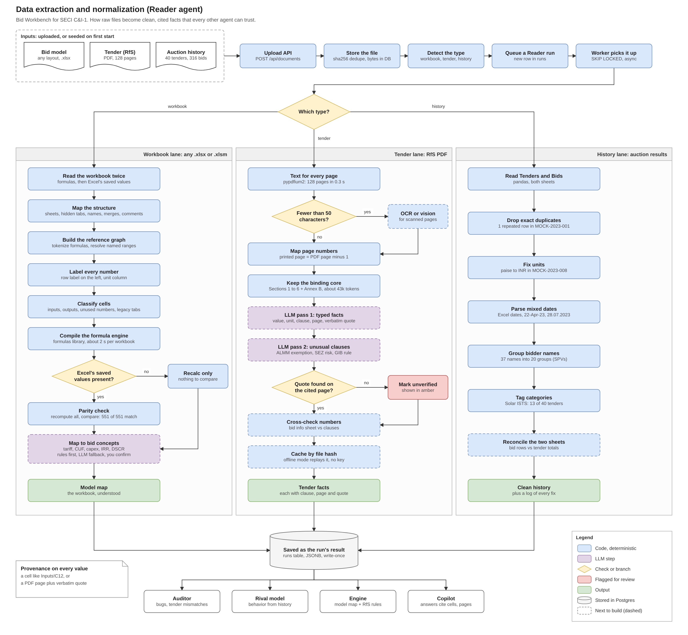

# Bid Workbench


An agentic workbench for a solar developer's bid team, built on SECI's 700 MW C&I-1 tender
(RfS SECI/C&P/IPP/15/0009/26-27). It reads the bid model, the tender and auction history,
finds what is wrong, and prices the bid: win odds and profit at every tariff.

## Run it

You need Docker Desktop (Mac or Windows) or Docker Engine (Linux), running.

```bash
git clone https://github.com/YOUR_GITHUB_USER/bid-workbench.git
cd bid-workbench
docker compose up --build
```

Open **http://localhost:3000**. The first build takes a few minutes; later starts take seconds.
The three sample files (bid model, tender PDF, auction history) load automatically.

No `.env` file and no API key are needed. Without a key the app runs in **offline mode**:
everything deterministic works fully and AI steps use cached results for the sample files.
To turn on live AI: `cp .env.example .env`, set `ANTHROPIC_API_KEY`, then `docker compose up -d`.

Stop with `Ctrl+C` (or `docker compose down`). Wipe the database with `docker compose down -v`.

## Check it works

| Check | How |
|---|---|
| One-call self test | open http://localhost:8000/api/selftest, expect `"ok": true` |
| Full eval suite, inside the container | `make eval` or `docker compose run --rm -e API_URL=http://api:8000 api pytest -q` |
| Outside-in smoke test | `make smoke` or `bash scripts/smoke.sh` |

## Try your own files

- In the UI: **Upload a file** (.xlsx, .xlsm or .pdf).
- From a terminal: `bash scripts/try-workbook.sh path/to/model.xlsx` prints what the app understood.
- API reference: http://localhost:8000/docs. The deterministic tools need no queue and no AI:

| Endpoint | What it does |
|---|---|
| `POST /api/documents` | upload a file (deduplicated by hash), queues the Reader |
| `GET /api/workbooks/{id}/structure` | sheets, named ranges, labelled inputs, unused numbers, legacy sheets |
| `GET /api/workbooks/{id}/parity` | recomputes every formula and compares with the values Excel saved |
| `POST /api/workbooks/{id}/evaluate` | recalculate with overrides, e.g. `{"overrides": {"Tariff": 2.5}, "outputs": ["Returns!C8"]}` |
| `POST /api/workbooks/{id}/goal-seek` | e.g. `{"variable": "Tariff", "target": "Returns!C8", "target_value": 0.14}` |
| `POST /api/auction/shortlist` | RfS §40.2: eligible capacity and H1 elimination from first-round bids |
| `POST /api/auction/allocate` | RfS §41: zones, L1 + 2% band and bucket filling from e-RA bids |
| `POST /api/runs`, `GET /api/runs/{id}` | queue an agent run, poll progress and result |

- Command line, no database needed:
  `docker compose run --rm api python -m app.cli goal-seek data/samples/bid_model.xlsx --variable Tariff --target 'Returns!C8' --value 0.14`

## How it is built

```
browser ──> web (nginx + React) ──> api (FastAPI) ──> db (Postgres 16)
                                                        ^
                                     worker (agents) ───┘   polls the runs table for jobs
```

**Agents** (one module each in `backend/app/agents/`; build status by phase in [docs/phases/PLAN.md](docs/phases/PLAN.md)):

| Agent | Job | Status |
|---|---|---|
| Reader | Excel, tender PDF and auction history into clean, cited facts | built (LLM tender extraction next) |
| Auditor | Model bugs and tender-vs-model mismatches, each fix priced in INR/kWh | target tests written |
| Scout | Web research on rivals, facts with URL and date | planned |
| Rival model | Per rival: chance of bidding at each price, and why. Frozen once computed | planned |
| Engine | Win odds and profit at every price point, and how they move with inputs | economics curve built |
| Copilot | Chat: what-ifs become scenarios, the engine reruns | planned |

**Database: three tables.** `documents` (files, bytes stored in the row), `runs` (every agent
execution: job queue, live progress and audit log; a finished run is never modified, which is what
makes a rival snapshot frozen), `scenarios` (named what-ifs). Agent outputs are JSONB, so no table per agent.

**Async:** the API writes a `queued` run; the worker claims it with `FOR UPDATE SKIP LOCKED`,
reports progress as it goes and stores the result. Scale workers with `docker compose up --scale worker=3`.

**Trust:** the formula engine recomputes the uploaded workbook and is checked against the values Excel
saved (551 of 551 match on the sample). Tender facts carry clause, page and a verbatim quote that is
checked against the page text.

## Data extraction flow



Editable source: [docs/solution/data-extraction-flow.drawio](docs/solution/data-extraction-flow.drawio). Open it at
app.diagrams.net or with the Draw.io extension in VS Code. Dashed boxes are next to build.

## Evals

`backend/evals/` holds the suite we run on every push (see `backend/evals/README.md`):
RfS worked examples for the auction rules, engine parity and goal seek on the sample model,
reader golden files, a generated workbook the app has never seen (different layout, no named
ranges, no cached values, ground truth computed in Python), black-box HTTP tests, and
**targets**: behaviour written down before it is built (marked xfail until it passes).

## Configuration

All optional, set in `.env` (see `.env.example`).

| Variable | Default | Meaning |
|---|---|---|
| `ANTHROPIC_API_KEY` | empty | empty = offline mode |
| `WEB_PORT` / `API_PORT` | 3000 / 8000 | change if those ports are taken |
| `LLM_MODEL_SMART` / `LLM_MODEL_FAST` | claude-sonnet-5-5 / claude-haiku-5-5 | models for extraction, research, chat |
| `SEED_SAMPLES` | true | load the sample files on first start |
| `SIM_SEED` | 42 | Monte Carlo seed, so results are reproducible |

## Troubleshooting

See [docs/RUNBOOK.md](docs/RUNBOOK.md). Most common: a port is busy (set `WEB_PORT`/`API_PORT` in `.env`),
or Docker Desktop is not running.

## What we built and why, what we left out, where it breaks

TODO before submitting.

## LLM cost

TODO: measured per run (each run logs tokens and cost).

## How this becomes a product a renewable developer would pay for

TODO: one page.

## Documentation

- [docs/EXPLAINED.md](docs/EXPLAINED.md): the solution and the evals in simple English
- [docs/solution/SOLUTION.md](docs/solution/SOLUTION.md): the design; [decisions](docs/solution/decisions.md)
- [docs/phases/](docs/phases/PLAN.md): build phases, each with its gate tests and reviewer Q&A
- [docs/problem/](docs/README.md): the brief, requirements traceability, domain primer, tender facts
- [ASSUMPTIONS.md](ASSUMPTIONS.md): every assumed number

Built with Claude Code: project rules in `CLAUDE.md`, phase commands in `.claude/commands/`.
